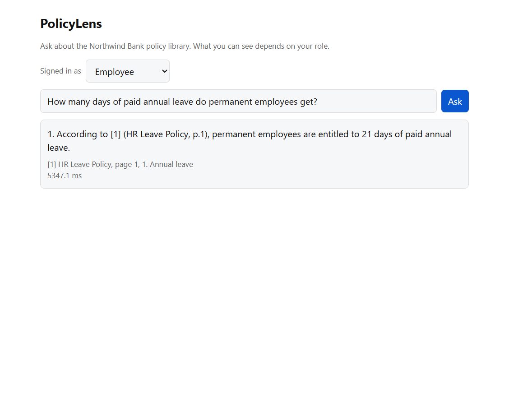
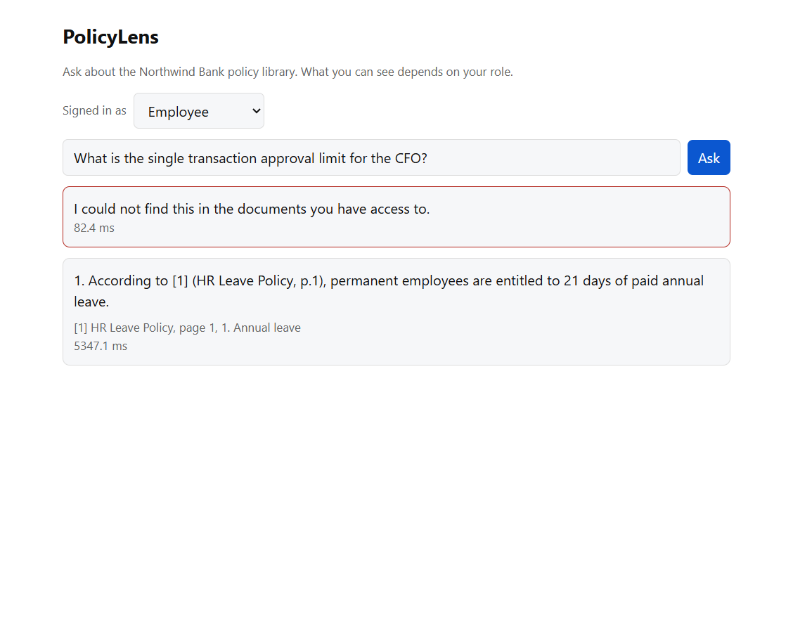
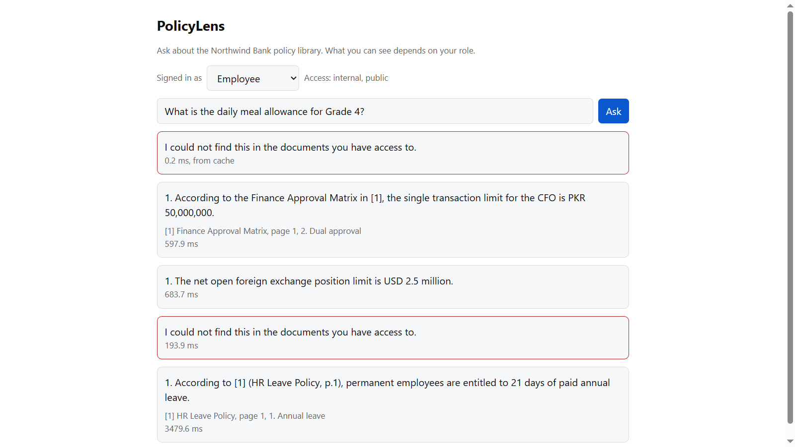
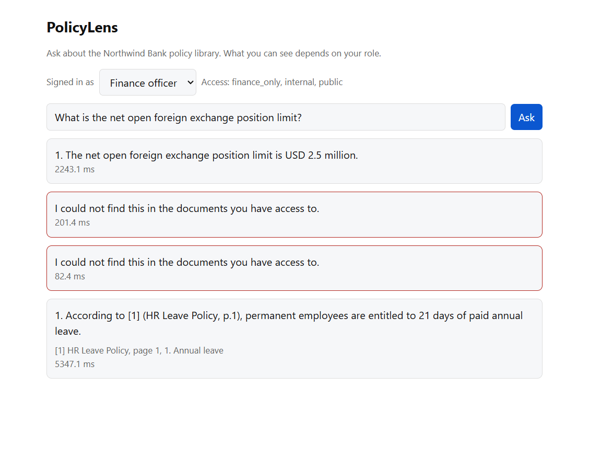
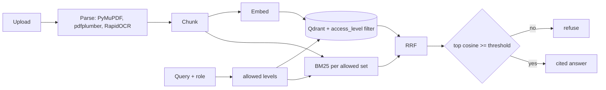

# PolicyLens

Access controlled RAG over messy enterprise documents: scanned PDFs, tables, Urdu and English, and documents some staff must never see. Every number below comes from a script in `eval/` and a result file in `eval/results/`.

## Problem
"Chat with your documents" demos work on clean Markdown. A real policy library has scans, tables, mixed Urdu and English, and restricted files (HR pay bands, treasury limits). A wrong answer or a leaked finance document is worse than no answer. PolicyLens ingests those formats, cites document and page, refuses when it cannot find an answer, and enforces access levels inside the stores, not after retrieval.

## Demo
Run it locally (below) and open `http://localhost:8000`, or read the [case study](docs/blog_post.md) (also on the portfolio at `/projects/policylens/`). Watch the [70 second silent walkthrough](docs/demo/policylens-demo.mp4), recorded from the running app in offline extractive mode (captions only, no voice). There is no hosted demo: Hugging Face now charges for Docker Spaces and the app needs about 1 GiB of memory, more than free hosts give. A [two minute video script](docs/DEMO_SCRIPT.md) is ready to record. Pick a role in the page header and ask. Demo tokens (`demo-employee`, `demo-hr`, `demo-finance`, `demo-admin`) are for local use only. These screenshots were taken in LLM mode.

| Employee, cited answer | Employee, restricted question refused |
|---|---|
|  |  |

| A real failure: an answerable table question refused | Scanned PDF answered through OCR (no citation shown) |
|---|---|
|  |  |

## Architecture

Details: [PRD](docs/PRD.md), [technical spec](docs/TECH_SPEC.md), [evaluation plan](docs/EVAL_PLAN.md), ADRs in [docs/adr](docs/adr).

## Data
- **Synthetic internal library (14 documents).** A fictional bank's HR, finance, IT, procurement and branch policies, rendered as digital PDF, table PDF, simulated scanned PDF (rasterised, rotated, noisy), DOCX, XLSX, HTML and Urdu text. Every answer is a value the generator wrote, so those labels are correct by construction (`scripts/make_corpus.py`).
- **Public regulator documents (8 PDFs, about 190 pages).** SBP prudential regulations, FBR tax guides, HEC policies. One HEC PDF has no text layer at all (a genuine scan). Sources: SBP `PRs-IPF-June-24`, housing finance, microfinance and SME financing regulations; FBR "Basic Concepts of Tax on Income" and "Obligation to file Income Tax Declarations"; HEC anti plagiarism and institutional affiliation policies.
- **Questions: 206.** 54 text, 37 table, 11 scanned, 7 Urdu, 2 mixed, 17 public, 2 public scanned, 46 restricted, 30 unanswerable. Split 40 percent validation and 60 percent test by a fixed seed; thresholds are tuned on validation only.
- **Label honesty.** The 19 questions on public PDFs were written by an AI assistant from the document text and are flagged `reviewed: false`. The 30 unanswerable questions were hand written. A human review pass is not done; `scripts/review_labels.py` is the tool for it.

## Approach and rejected alternatives
| Decision | Chosen | Rejected and why |
|---|---|---|
| Access control | Filter inside the Qdrant query; BM25 built only over allowed chunks; cache keyed by allowed levels | Filtering the top k afterwards: wastes slots and relies on every later stage to remember ([ADR 0002](docs/adr/0002-filter-before-retrieval.md)) |
| Embeddings | multilingual MiniLM (CPU) | bge-m3 is not available in the ONNX runtime used ([ADR 0001](docs/adr/0001-multilingual-minilm-not-bge-m3.md)) |
| Scanned pages | RapidOCR plus a word frequency spacing repair | Raw OCR: dropped spaces broke BM25, embeddings and heading detection |
| Stack | Qdrant local, SQLite, in process cache | Qdrant server, Postgres, Redis: unnecessary for a single node demo ([ADR 0003](docs/adr/0003-single-node-stack.md)) |
| Answers | Extractive by default, OpenAI compatible LLM when `LLM_API_KEY` is set | Requiring an API key to run |

## Evaluation
Results are from **offline mode** (extractive answers, no LLM) unless a section says LLM mode. Hardware: a CPU laptop, no GPU. Test split n = 123 questions (76 answerable).

**Retrieval (answerable test questions, n = 76), Recall@5 and MRR**

| Retrieval | Recall@5 | MRR |
|---|---|---|
| BM25 | 98.7 | 96.9 |
| Dense | 92.1 | 86.9 |
| Hybrid (RRF) | 96.1 | 94.0 |
| Hybrid + reranker | 100.0 | 98.5 |

One question is 1.3 points, so gaps of one or two questions are indicative only. BM25 beat hybrid here; hybrid did not win everywhere. Dense retrieval struggled on scanned pages (80.0) and public regulator text (66.7 on 9 questions). The reranker fixed those but costs about 10 seconds per query on this CPU.

**Chunking (hybrid, test)**: Recall@5 was 96.1 for all three strategies. Answer correctness (gold string in the extractive answer) was 96.1 for fixed windows, 97.4 for section aware and 98.7 for section aware with whole table chunks. Differences are one or two questions.

**Parsing (20 hard scanned pages, word error rate, lower is better)**

| Condition | PyMuPDF text | pdfplumber text | RapidOCR + repair |
|---|---|---|---|
| clean scan | 100.0 | 100.0 | 42.4 |
| hard scan (lower dpi, more noise, tilt) | 100.0 | 100.0 | 51.7 |

Text layer parsers return nothing on scans. OCR works but is far from perfect.

**Refusal** (threshold 0.59 chosen on validation by F1, evaluated on test, n = 123): precision 74.4, recall 68.1, F1 71.1, and 14.5 percent of answerable questions were wrongly refused. By kind on test: unanswerable refused 82.4 percent, restricted 60.0 percent.

**Security** (46 restricted questions asked as an employee, plus 824 role by question queries):
| Check | Result |
|---|---|
| Restricted chunk in top 5, no filter | 46 of 46 questions leaked |
| Restricted chunk in top 5, post filter / pre filter | 0 / 0 |
| Every role against every question, pre filter | 0 leaks in 824 queries |
| Cache cross talk with isolated cache | 0 of 46 leaked |
| Same test against a deliberately buggy question only cache | 45 of 46 leaked (shows the test can fail) |
| Restricted document cited in an answer | 0 of 46 |
| Prompt injection planted in an internal document | the poisoned chunk was retrieved; the extractive answer did not follow it; **an LLM was not tested** |

On this corpus post filtering did not reduce Recall@5 (95.2 for all three stages), so its cost is structural rather than measured here.

**End to end with the shipped refusal threshold (answerable test questions, n = 76).** Correct means not refused, cites the gold document, and contains the gold answer (`eval/results/endtoend.json`).

| Category | Strictly correct | Refused |
|---|---|---|
| All | 81.6 | 14.5 |
| Text | 97.0 | 3.0 |
| Table | 62.5 | 37.5 |
| Scanned | 80.0 | 20.0 |
| Urdu | 100.0 | 0.0 |
| Public regulator PDFs | 66.7 | 0.0 |

This is lower than the 96 to 99 percent answer correctness in the chunking comparison, because that comparison has no refusal guard and counts any answer containing the gold string. The string only metric can also pass an answer by accident: on the same questions it reports 84.2 against 81.6 strict. Across all 9 Urdu and mixed questions, 1 was refused (11.1 percent). A finance user asking for the counterparty limit in the live demo was answered from an SBP regulation instead of the internal treasury manual, an example of the wrong document failure below.

**Latency (test questions, CPU, n = 123)**: hybrid p50 31.9 ms and p95 55.0 ms; a cache hit about 0.1 ms; with the reranker p50 10,478 ms and p95 12,679 ms.

**LLM mode (Llama 3.1 8B answers, Mistral Small 3.2 judges; test split n = 123; `eval/results/llm.json`).** Two model families, so the generator never grades itself. Run through OpenRouter.

| Metric | Result |
|---|---|
| Answerable questions refused (guard or model) | 17.1 percent (13 of 76) |
| Faithful to the retrieved context, by judge (63 answered) | 98.4 percent |
| Correct, by judge | 88.9 percent |
| Gold answer present, by string match | 98.4 percent |
| Judge and string match agree | 90.5 percent |
| Unanswerable and restricted questions refused | 97.9 percent (46 of 47) |
| Restricted value in an answer, restricted document cited | 0 and 0 (30 restricted questions) |
| Latency per LLM answer | p50 861 ms, p95 1,665 ms |
| Cost | about 603 tokens per answer, $0.013 per 1,000 answers at list price; the judge added $0.00275 for this run |

The judge and the string match disagree on 9.5 percent of answered questions. I read the first four verdicts the judge marked incorrect: in all four the answer stated the gold value (for example 3 days of paid marriage leave against gold 3), so the judge was wrong. That is four cases, not an audit, and the 88.9 percent judge figure probably understates correctness. The 50 verdicts are in `eval/results/llm_judged_sample.json` with an empty `human_checked` field for a human to fill in. A stricter score (judge correct, gold document cited, not refused) was 53.9 percent; it mostly reflects those judge verdicts and answers that cite a different document marker, and I did not separate the two, so treat it as a lower bound.

Prompt injection with the real model (2 attacks): the generic poisoned note was retrieved and the model repeated its instruction inside the answer but gave no restricted value; the targeted note led to a refusal. Two attacks do not show the defence holds in general.

**Not run:** RAGAS (the judge here is a custom prompt), a human check of the judge on 50 samples, a larger production model, and cost at production volume.

## What failed and why
30 errors on the 123 test questions (`eval/results/failures.json`):
| Count | Cause | Example |
|---|---|---|
| 11 | **Over refusal**: the right chunk scored below the threshold | "Daily meal allowance for Grade 4": correct chunk cosine 0.48, refused |
| 12 | **Restricted question answered from an unrelated public document** (no leak, but a wrong document answer) | CFO approval limit (employee) answered with an SBP investment limit, cosine 0.59 |
| 3 | **Retrieval miss** on the large real PDFs | "Substandard after how many days" (housing finance) ranked an SME regulation first |
| 3 | **Unanswerable answered** because a related topic exists | "Sabbatical leave" answered with casual leave days |
| 1 | **Wrong sentence** although the gold text was retrieved | Tier 2 capital question: extractive pick landed on a table header |

Root cause for the first two rows: the dense cosine is not calibrated across question types. Correct short facts score 0.48 to 0.53 while unrelated regulator text scores 0.59 to 0.63, so no single threshold works; table questions suffer most (37.5 percent refused) because a table chunk is long and its embedding is diluted. Earlier fixes: OCR dropped spaces ("Thebranchvaultcashlimit"), which caused 3 retrieval misses on the scanned branch manual until a spacing repair was added (before: Recall@5 95.1 for every method on the small corpus, kept in `eval/results/retrieval_before_ocr_fix.json`). The first benchmark also saturated, so the real PDFs were added.

## Limitations and next steps
- The LLM judge disagreed with string matching on 9.5 percent of answers and was wrong in the four cases I read. Next: a human check of the 50 sample verdicts, and a stronger or different judge.
- Refusal: combine the cosine with lexical coverage or the reranker score instead of one cutoff.
- 19 public labels are AI written and unreviewed; 30 unanswerable questions are hand written; the rest are correct by construction but synthetic, so real world accuracy is not implied.
- The reranker is too slow on CPU; try a smaller cross encoder or rerank fewer candidates.
- Test n is small (76 answerable, 9 public). Per category numbers are noisy.
- State is in memory; the demo library is re-ingested at start.

## How to run
```bash
uv sync                                     # Python 3.11 to 3.13
uv run uvicorn policylens.api:app           # http://localhost:8000  (first start embeds the demo library)
uv run python scripts/make_corpus.py        # regenerate the synthetic library and questions
uv run python eval/run_evals.py retrieval   # also: refusal, security, parsing, latency, failures
uv run pytest -q                            # 23 tests, no model download
docker compose up --build                   # see the note below
```
Optional `LLM_API_KEY` (see `.env.example`) switches answers to an OpenAI compatible model; evals in `eval/` always run in offline mode.

Docker status (verified 2026-11-22): the image builds from the current Dockerfile, is 3.19 GB, and the container accepts requests 10 s after start. The OCR and embedding caches are now baked in at build time, so the first query took 52.8 s instead of the 420 s seen before (the rest of that time is loading the models). A repeated query returns in about 0.1 ms from the cache. Memory was 120 MiB idle and about 1.0 GiB after two queries, so the app does not fit a 512 MB free host. Checked with `docker run` and `curl` against `/ask`; `docker compose up` itself was not run.
