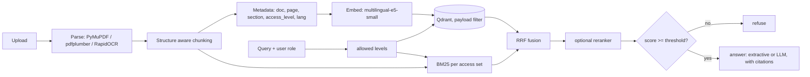

# PolicyLens: technical spec

## Architecture

## Components
| Module | Job |
|---|---|
| `parsers.py` | route by file type; PDF page text via PyMuPDF; if a page has under 30 characters, OCR it; tables via pdfplumber |
| `chunking.py` | strategies: `fixed`, `section`, `section_table` (tables kept whole as one chunk) |
| `index.py` | Qdrant (local mode) with payload index on `access_level`; BM25 indexes keyed by allowed level set |
| `retrieve.py` | filter first, dense + BM25, RRF, optional rerank |
| `guard.py` | refusal threshold on top dense cosine (tuned on validation) |
| `answer.py` | extractive answer with citations; OpenAI compatible LLM when `LLM_API_KEY` set |
| `cache.py` | semantic cache keyed by (allowed levels, query embedding) |
| `auth.py` | token to user and role, SQLite |
| `api.py` | FastAPI: `/ingest`, `/ask`, `/docs`, `/health`, `/logs` |
| `evals/` | parsing benchmark, chunking, retrieval ablation, refusal tuning, security suite, latency |

## Data model
`Chunk(id, doc_id, title, page, section, kind[text|table], access_level, lang, text)`.
Access levels: `public < internal < hr_only | finance_only`. Role grants: employee {public, internal},
hr {+hr_only}, finance {+finance_only}, admin all.

## Security model
- Filter is applied in the vector query and when choosing the BM25 index, before any scoring. No post filter.
- Cache keys include the allowed level set; a finance answer can never be served to an employee.
- Citations only reference chunks that passed the filter.
- The LLM prompt only ever contains filtered chunks and treats them as untrusted data (injection instructions in documents are quoted, not followed).

## Failure modes
Bad OCR, table split across pages, threshold too high (over refusing) or too low (hallucinating), embedding
model missing offline, LLM outage (falls back to extractive).

## Deliberate shortcuts (upgrade path)
- Qdrant local mode, not a server: same payload filter API; switch via `QDRANT_URL`.
- SQLite instead of Postgres, in process cache instead of Redis: single node demo; swap when scaling.
- Thin OpenAI compatible client instead of LiteLLM: one provider at a time is enough here.

## Build order
1. Synthetic corpus + public docs 2. parsers + parsing benchmark 3. chunking 4. index/retrieve
5. guard + answer 6. API/auth/cache 7. eval sets + harness 8. security suite 9. UI, Docker, CI, README.
